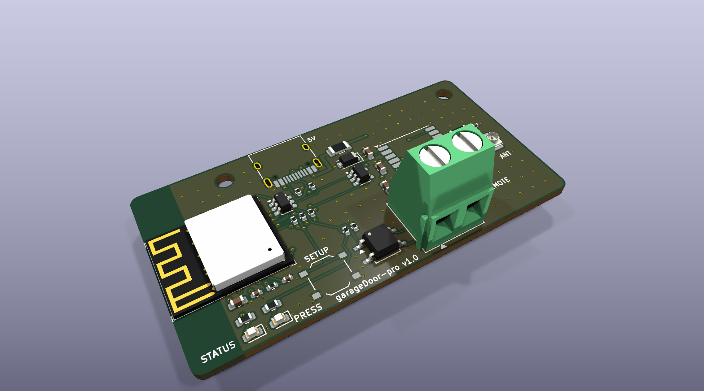

# garageDoor-pro

**A small box in the car that opens the garage door by itself when you leave home and when you arrive.**
No phone, no app: an ESP32-C3, a GPS module and one transistor that presses the button of a spare
remote, powered over USB-C from the car. Home is set once from a small Wi-Fi web panel.


<p align="center">
  
</p>

## How it works

The car's USB socket switches off with the ignition, so the board boots when the car starts and
loses power when it stops. The underground garage has no GPS reception, so the board remembers in
flash where the car was last parked.

| State at boot | What happens |
|---|---|
| Parked at home | Presses the remote 10× (every 2 s) while you drive out, then switches to *away* once the GPS is past the leave radius |
| Parked away | Waits for a GPS fix |
| Away, inside the arrive radius | Presses every 2 s for up to 180 s, saves *home* |
| Drove past home | Detects leaving the radius again and stops pressing |

Two radii (150 m arrive, 300 m leave by default, both configurable) stop GPS jitter at the edge from
flapping the state. A fix only counts with `gnssFixOK`, ≤ 50 m accuracy and ≥ 4 satellites. The
state machine is pure C and unit-tested on the host with AddressSanitizer and UBSan.

## Two ways to build it

| | Prototype | Custom PCB |
|---|---|---|
| Parts | ESP32-C3 SuperMini, GPS module, NPN, a few resistors | ESP32-C3-MINI-1 on a 4-layer board, assembled by JLCPCB |
| Effort | About an hour on perfboard | Order Gerbers, BOM and CPL as provided |
| Guide | [prototype/README.md](prototype/README.md) | [hardware/ORDERING.md](hardware/ORDERING.md) |

Both run the same firmware.

## Documentation

| | |
|---|---|
| [prototype/](prototype/README.md) | Perfboard build: parts, layout, assembly, bench test, 3D-printable case |
| [docs/user-guide.md](docs/user-guide.md) | Installing in the car and setting it up |
| [docs/design.md](docs/design.md) | Behaviour, parts, circuit and PCB decisions |
| [firmware/README.md](firmware/README.md) | Build, flash, OTA, LED codes |
| [hardware/](hardware/ORDERING.md) | KiCad project, Gerbers, BOM, CPL, schematic PDF, STEP model |

## Repository layout

```
firmware/    ESP-IDF project (GNSS, trip state machine, captive-portal web panel, OTA, host tests)
hardware/    KiCad design; gen/ holds the Python generator, netlist.py is the single source
prototype/   perfboard build guide, wiring diagrams, 3D-printable case
docs/        design notes and user guide
```

## Quick start

```bash
cd firmware && . ~/esp/esp-idf/export.sh && idf.py build flash
```

Run the host unit tests with `firmware/test/run.sh`.

## License

[MIT](LICENSE). Espressif symbol and 3D files in `hardware/lib/` keep their own license.
