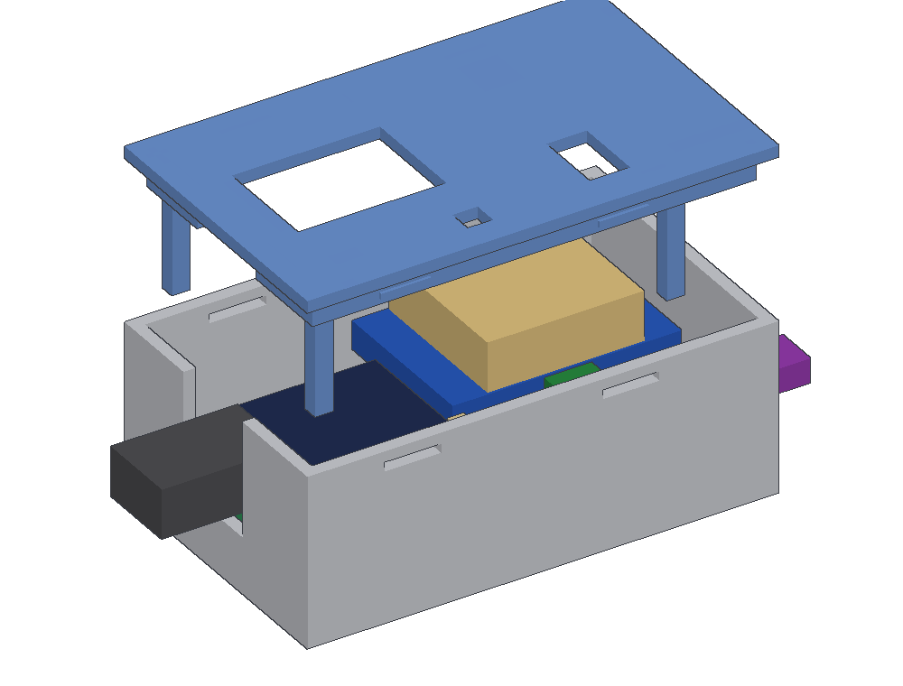

# Prototype build (perfboard)

The garageDoor board, built by hand from ready-made modules on a perfboard. It runs the same firmware
as the PCB version, and the build takes about an hour.

```
                ESP32-C3 SuperMini
car USB-C ────► USB-C
                3V3   ────────────────────────────────────► GPS VCC
                GND   ────────────────────────────────────► GPS GND
                GPIO5 ◄──────────────────────────────────── GPS TX
                GPIO4 ────────────────────────────────────► GPS RX

                                                   ┌ C ──────► screw 1 ─┐  across the
                GPIO7 ──┬── R1 330Ω ──┬────── B ── Q1 NPN               ├─ remote's button,
                        │             │            └ E ──┐              │  + side to screw 1
                     R3 1k       R2 100k                 │              │
                        │             │                  │              │
                  D1 red LED          │                  │              │
                        │             │                  │              │
                GND  ───┴─────────────┴──────────────────┴──► screw 2 ──┘
                GPIO8: blue LED on the SuperMini (status)   GPIO9: BOOT button (= SETUP)
```


- **Q1, an NPN transistor,** connects the two screw-terminal wires like a pressed button. Unpowered,
  it stays open. It switches fully on and carries far more than any remote needs, including remotes
  whose button switches the whole remote on.
- **Polarity matters:** screw 1 (collector) goes to the button's **+ side**, screw 2 (GND) to the
  **− side** (see Bench test). The remote's − side then shares the board's GND, which is harmless:
  the remote runs on its own battery and has no other connection.
- **R1** (330 Ω) drives Q1's base (~8 mA) and **R2** keeps Q1 off while the ESP32 boots.
- **R3 and D1:** the red LED lights whenever the board presses the remote. If it flashes and the
  remote doesn't react, the problem is between Q1 and the remote.

## Parts list

| # | Part | Qty | Notes | ~€ |
|---|------|----:|-------|---:|
| 1 | **ESP32-C3 SuperMini** | 2 | Get the **standard** one, not "SuperMini **Plus**": the Plus has different pins and an RGB LED on GPIO8. The second one is a spare. | 3 each |
| 2 | **GPS module GY-GPS6MV2** (u-blox NEO-6M, also sold as GY-NEO6MV2), with its 25 × 25 mm patch antenna | 1 | Plugs into a 1×4 socket on the board (step 7) and runs from the SuperMini's **3V3** pin. The layout and the case are drawn for this board: about 25 × 36 mm, pins `VCC RX TX GND` on a short edge. Another 3.3 V UART module works with the firmware too (it reads NMEA or u-blox UBX at any baud rate), but needs its own wiring to I12–L12 by its labels (VCC I12, RX J12, TX K12, GND L12) and may not fit the case. | 8–15 |
| 3 | **NPN transistor, TO-92**: 2N2222 / PN2222, S8050, 2N3904, BC547 or BC337 | 2 | Q1. Any common small NPN works; the legs come in a different order on different parts (assembly step 3). The second one is a spare. | 0.1 |
| 4 | Resistor 330 Ω, ¼ W | 1 | R1. A resistor assortment kit is handy. | – |
| 5 | Resistor 100 kΩ, ¼ W | 1 | R2 | – |
| 6 | Resistor 1 kΩ, ¼ W | 1 | R3 | – |
| 7 | LED red, **3 mm** | 1 | D1. A 5 mm LED doesn't fit between R2 and the board edge. | 0.1 |
| 8 | Screw terminal, 2-pin, 5.08 mm pitch, e.g. KF301-2P | 1 | J1, for the remote wires. 5.0 mm pitch fits too; 3.5 / 3.81 mm don't. | 0.3 |
| 9 | Perfboard **4 × 6 cm**, 2.54 mm, double-sided with plated holes, **20 × 14 holes**, numbers 1–20 and letters A–N printed on it | 1 | The guide uses its printed hole names. Check the print direction before you start (Layout). Packs of several are cheap. | 1 |
| 10 | **Round machined-pin female header** (socket strip, stackable), 2.54 mm: 2 × 1×8 and 1 × 1×4 | 1 strip of 40 | The SuperMini and the GPS module plug in, so both can be swapped. Break the pieces off a 1×40 strip (cut through a contact, you lose one each time). The case is drawn for a body 3 mm tall; measure yours (Case). | 1 |
| 11 | **Round machined-pin male header**, 2.54 mm: 2 × 1×8 and 1 × 1×4 | 1 strip of 40 | For the SuperMini and the GPS module. Round sockets take round pins only: the square pins that come with the modules are too thick and wreck the contacts. | 1 |
| 12 | Insulated hookup wire, 26–30 AWG (silicone or wire-wrap) | 1 m | W1–W5 and the remote wires | 2 |
| 13 | Bare tinned copper wire, 0.4–0.6 mm | – | Trails T1–T7; the resistor leg offcuts are enough | – |
| 14 | **Spare garage remote** for your door, already working | 1 | It stays in use as the transmitter | own / 15–30 |
| 15 | USB car charger + USB-C cable | 1 | On a socket that **switches off with the ignition**. Some SuperMini clones lack the USB-C resistors that a C-to-C cable needs and get no power from a USB-C charger (or a USB-C-only Mac): if it shows no sign of life (no LED at all, no `/dev/cu.usbmodem…` port on the Mac), use a **USB-A charger with an A-to-C cable** (and a USB-A hub or adapter on the Mac). | 10 |
| 16 | **3D-printed case** (`case/garageDoor-case.3mf`, see Case) | 1 | PETG or ASA, about 25 g | 1 |
| 17 | Heat-shrink tubing, double-sided tape / Velcro | – | | – |

Tools: temperature-controlled soldering iron (~330 °C, fine tip), solder 0.5–0.8 mm (leaded Sn60/63
is the easiest), flux pen, flush cutters, tweezers, multimeter with continuity beep, and a 3D printer
(or a print service) for the case.

**Total:** about €25–35 without the remote and charger. The GPS module is the biggest item.

## Layout


The guide is drawn for the green **40 × 60 mm** perfboard (20 × 14 holes) that has `40*60MM`, the
numbers **1–20** and the letters **A–N** printed on one side. Every hole is named by that print: **printed letter + printed
number**, e.g. C11 = row C, column 11.

- **Check the print direction first.** Hold the board printed side up with `40*60MM` at the top and
  the numbers along the bottom, **1 on the left**. The letters must run up the left edge with **A at
  the bottom**.
  - If A is at the **top** instead, stop: on that board the hole names come out mirrored, and the
    SuperMini would end up with its pins swapped. Use a board printed the other way, or ask for the
    layout to be mirrored first.
- **Parts go on the printed side.** That's the left half of the drawing, and the SuperMini sits
  there **chip side up with USB-C on the left**.
- **Soldering happens on the other side.** Turn the board over like a page: the SuperMini's USB-C
  end is now on the **right**, the screw terminal on the left. That's the right half of the drawing.
  That side has **no print at all**, so the drawing shows none either: dashed outlines mark where
  the parts sit on the other side, and every solder joint is labelled (SuperMini pin names, GPS
  pins, Q1 legs E/B/C, J1 screws 1/2, D1+ / D1−). The trails and wires below are described by those
  joints.
- The circuit uses rows **A–M** and columns **2–18**. The GPS module lies on top of columns 12–20,
  rows F–N, and reaches about 8 mm past the right edge.

`make_layout.py` draws all the pictures in `img/` and checks that the trails and wires produce
exactly the circuit above.

### Bridge, trail or wire?

| Connection | Use | Here |
|------------|-----|------|
| Two **neighbouring** holes (one step) | a short trail, or a **solder bridge**: heat both pads and feed solder until it flows across | T6, T7 |
| A **straight run** over 2+ neighbouring holes | a **trail**: bare tinned wire laid flat over the pads, soldered at **every** pad. Don't chain solder blobs; they crack. | T1–T5 |
| Anything else (long runs, crossing other connections, under the SuperMini) | **insulated wire**, soldered pad to pad on the bottom | W1–W5 |

Keep trails centred on their row. A trail must never touch the pad beside it, so watch the parallel
trails T2/T3 (Q1's base next to GND). Leave every hole that isn't in the drawing unsoldered.

## Assembly

1. **Check the SuperMini.** The pin labels should read `5V G 3.3 4 3 2 1 0` on one side and
   `5 6 7 8 9 10 20 21` on the other. Hold it **chip and buttons facing up, USB-C on the left**:
   then `5V … 0` is the upper row and `5 … 21` the lower one, and that's how it goes onto the
   board. If its pins aren't soldered on yet, solder **round** male pins on now: 1×8 on each side,
   plastic underneath, long side down.
   - **The GPS module** gets a 1×4 round male header the same way: plastic on the underside (the
     side without the chip), long pins pointing down, soldered on the chip side.
   - Square pins already on a module? They don't belong in round sockets; desolder them, or use
     standard square-hole female headers instead and build the case for their height (Case).
2. **Sockets.** Board **printed side up**, 1 on the left, A at the bottom (Layout). Plug both 1×8
   round sockets onto the SuperMini and set it in chip side up, USB-C toward the left edge: the
   `5V … 0` row in **K2–K9** (5V in K2) and the `5 … 21` row in **E2–E9** (5 in E2).
   - The rows are 6 holes (15.24 mm) apart on the SuperMini. If yours don't line up with K and E,
     stop and measure.
   - **GPS socket:** plug the 1×4 round socket onto the GPS module's pins and set the module in
     chip side up, its board lying toward the right edge (it reaches past it), the socket in
     **I12–L12**, one pin per row in column 12. Its labels must read **VCC on I12, RX on J12, TX on
     K12, GND on L12**. Held with the pins at the top, that's `VCC RX TX GND` from left to right. If
     your module's order is different, stop: the wires in step 5 would be wrong for it.
   - Solder **all 20** socket pins from the bottom, then pull both modules off again. The unused
     SuperMini pins hold it in place.
   - **No sockets for the SuperMini?** Solder it in directly with its male pins: pins
     long side down through K2–K9 and E2–E9, SuperMini on top (check the orientation twice), solder
     on top, then from the bottom, and trim the long ends flush underneath. Test-fit a USB-C cable
     before going on: the module now sits only about 2.5 mm above the board.

   
3. **Parts on the printed side** (solder from the bottom, and keep the cut-off legs for the trails):
   - **R1 330 Ω:** C4 and C9, lying flat.
   - **R2 100 kΩ:** C10 and B10, standing upright with the body on C10 (bend the B10 leg down
     alongside the body).
   - **R3 1 kΩ:** A4 and A8, lying flat along the bottom edge.
   - **D1 red LED:** **long leg (+) in A9**, short leg (the flat side of the rim, −) in A10.
   - **Q1 NPN transistor:** its three legs in one column: **emitter in B12, base in C12, collector
     in D12**. Read the number on its flat side, then turn it so the legs land like that:

     | Transistor | Legs (flat side facing you, legs down, left to right) | Flat side faces |
     |------------|------|-----------------|
     | 2N2222 / PN2222, S8050, S9013, 2N3904 | E B C | right, toward the screw terminal (as drawn) |
     | BC547, BC548, BC337 | C B E | left, toward R2 and the SuperMini |

     Another part: check its datasheet; only E in B12, B in C12, C in D12 is right. Leave a few
     millimetres of leg under the body.
   - **J1 screw terminal:** D18 (screw 1) and B18 (screw 2), with the wire openings toward the
     right edge.

   
4. **Trails on the bottom** (board turned over like a page: no print, USB-C end on the right).
   Hole names in brackets are the printed ones from the parts side, for cross-checking:
   - **T1:** SuperMini pin 7 → R1 → R3, straight down 4 pads (E4–D4–C4–B4–A4). B4 has no part, the
     trail just passes it.
   - **T2:** R1's other leg → R2's upper leg → Q1 base, 4 pads in a row (C9–C10–C11–C12). C11 has
     no part, the trail just passes it.
   - **T3:** R2's lower leg → Q1 emitter → J1 screw 2, all along the row (B10–B18). This is GND.
   - **T4:** Q1 collector → J1 screw 1, along the row (D12–D18).
   - **T5:** SuperMini G straight up 3 pads (K3–L3–M3): two GND pads for W2 and W5.
   - **T6:** R3's leg next to the LED → D1+, neighbours (A8–A9).
   - **T7:** D1− → R2's lower leg, neighbours (A10–B10). R2's lower leg is GND.

   
5. **Wires on the bottom** (the GPS socket's 4 joints are the short column three pads beyond the
   SuperMini's pin 0, VCC at the bottom):
   - **W1:** GPS TX → SuperMini pin 5 (K12 → E2).
   - **W2:** the middle pad of T5 → T3, which makes T3 GND (L3 → B11).
   - **W3:** GPS RX → SuperMini pin 4 (J12 → K5).
   - **W4:** GPS VCC → SuperMini 3V3 (I12 → K4).
   - **W5:** GPS GND → the top pad of T5 (L12 → M3).

   Lay W3 and W4 across the free pads between the SuperMini's two rows, not over its other pins.
   The wires may cross each other; their insulation keeps them apart.

   
6. **Measure before plugging anything in** (multimeter, SuperMini unplugged or, if soldered in, the
   USB cable out). The pads go through the board, so measure on the printed side, where you can read
   the names. With the SuperMini soldered in, the "open" checks between its pins may show a high
   resistance through the module instead of nothing; only a beep is a fault:

   | Between | Expect |
   |---------|--------|
   | K4 (3V3) and K3 (GND) | **open, no beep**. If this beeps, find the short before going on. |
   | K2 (5V) and K3 (GND) | open |
   | K4 and I12, K3 and L12, K5 and J12, E2 and K12 | beep (connected) |
   | E4 (GPIO7) and A4 (R3) | beep |
   | E4 (GPIO7) and C12 (Q1 base) | ~330 Ω |
   | C12 and K3 (GND) | **no beep** (R2's 100 kΩ; a beep means T2 touches T3) |
   | B12, A10 and screw 2, each to K3 (GND) | beep |
   | A8 and A9 | beep |
   | Screw 1 and D12 (Q1 collector) | beep |
   | Screw 1 and screw 2 | **no beep** |
   | Screw 1 and E4, screw 1 and C12 | no beep |
   | Every pair of neighbouring pads in K2–K9, E2–E9 and I12–L12 | open |
7. **GPS.** Plug the module into its socket as in step 2: chip side up, its board toward the right
   edge, **VCC in I12, RX in J12, TX in K12, GND in L12**. Push it straight down until the plastic of
   its pins sits on the socket.
   - Clip the antenna's cable onto the module's small round socket (press straight down until it
     snaps). Stick the antenna on the module with the foam tape on its back, **ceramic side up**,
     centred, so it doesn't stick out past the module's edges.
   - Lead the cable over the module's far end to the socket. Coil any spare length loosely (no
     tighter than a pencil) and tuck it into the free corner beside J1, front right; the case keeps
     that corner free for it.

   
8. **Plug in the SuperMini** and flash it from the Mac, with the SuperMini on USB:

   ```bash
   cd firmware && . ~/esp/esp-idf/export.sh && idf.py build flash monitor
   ```

   If no `/dev/cu.usbmodem…` port shows up, hold BOOT while plugging in the USB.

## Bench test

Careful near the real door: once home is set and the board last stopped at home, **every power-up
presses the remote 10 times** (that's "leaving"). Test away from the door or with the remote's
battery out until the wiring is proven.

1. **First start:** the log says `start: NO_HOME` and the blue LED blinks fast, because the setup
   Wi-Fi is on.
2. **GPS:** near a window, the log shows `receiver found at 9600 baud (NMEA)` (ATGM336H, NEO-6M; u-blox M9/M10
   modules show `115200 baud (UBX)`). Within about a minute the panel shows a fix.
3. **Switch:** on the phone, join **GarageDoor-XXXX** (open, no password), then tap **Press the
   remote once**. **The red LED D1 flashes.**
   - No flash: GPIO7 isn't reaching R3/D1. Check T1 and that D1's long leg is in A9.
   - Then, remote not connected yet: multimeter on Ω, red probe on screw 1, black on screw 2, and
     tap **Hold the remote for 5 s**. D1 stays lit and the meter drops from open to a low reading
     for 5 s. Still open: Q1 isn't switching; check T2 and T3 and Q1's leg order (step 3).
4. **Remote, on its own first:** open the spare remote and solder two thin wires across the
   button's contacts (the two sides it connects). Keep them short and away from the remote's
   antenna (the copper loop or wire near its edge). Touch the two free wire ends together: the
   remote must transmit (its LED lights, the door reacts).
   - Nothing happens: the problem is the wires or joints on the remote. Fix that first; the board
     can't do better than a pressed button.
5. **Remote on the board:** find the button's **+ side**: battery in, multimeter on DC volts across
   the two button contacts. If it reads positive, the red probe is on the + side; if negative, the
   black one is. **+ side → J1 screw 1, − side → screw 2.** Tap **Press the remote once**: D1
   flashes, the remote's LED lights and the door reacts. Tap **Hold the remote for 5 s**: the
   remote's LED stays on steadily for the whole 5 s.
   - Nothing at all: the wires are the wrong way round. Swap them once.
   - The remote's LED flickers or stays dim: Q1 isn't fully on. Check E4 ↔ C12 reads ~330 Ω and
     Q1's leg order (assembly step 3).

## Case



`case/garageDoor-case.3mf` holds both parts, already turned for printing: the **tray** standing on
its floor and the **lid** upside down. Open it in Bambu Studio, PrusaSlicer, OrcaSlicer or Cura and
print it as it is, **no supports**. Outside it's 75 × 47 × 30 mm.

- **Material: PETG or ASA**, not PLA: in a parked car in summer PLA goes soft. 0.2 mm layers, 3 walls,
  15 % infill.
- **Tray:** the perfboard rests on four corner seats with small lips around them, which keep it in
  place, and a pillar holds up the GPS module's free end so its four pins don't carry it alone. The
  left wall has a notch for the USB-C plug, the right wall a window for the remote's wires.
- **Lid:** a window over the SuperMini (you see the blue status LED and press BOOT through it with a
  pen), a small hole over the red LED D1, a slot over J1's two screws (tighten or loosen the
  remote's wires with a small screwdriver, lid on), and three posts that press the perfboard down
  onto its seats. It clicks into four windows near the top of the tray's long walls; push a
  fingernail into one to open it.
- **Assembly:** thread the remote's two wires through the right-hand window and into J1 first, then
  set the board in, USB-C toward the notch, and click the lid on.
- `case/make_case.py` builds the file and checks that the case clears the perfboard, the SuperMini
  and the GPS module in their sockets, the antenna on top of the GPS, J1, Q1, R2, D1, the USB-C
  plug and the remote's wires (the plug also for a SuperMini soldered in directly). It also keeps
  room free for the antenna cable: over the GPS module's far end (about 6 × 25 × 9 mm) and in the
  corner beside J1 (about 14 × 10 × 12 mm) for the spare length. The sizes it assumes are at the
  top of the script. **Measure your sockets:** `SOCKET_H` is the height of their plastic above the
  board (3 mm as drawn; 8.5 mm for standard square-hole female headers), and the case grows or
  shrinks with it. If that or your GPS board differs, change it there and run it again
  (`python3 prototype/case/make_case.py`).
- Built with the SuperMini soldered in directly (no sockets), it sits 3 mm lower: the USB-C notch
  still fits.

## Install in the car

- **The whole case goes where the GPS antenna sees the sky but the sun doesn't bake it** (the
  SuperMini is rated to 85 °C): lid up, under a plastic trim near the rear window or the windscreen,
  or in a shaded tray at the front of the dashboard. Hold it with Velcro or double-sided tape.
  - GPS works through plastic and glass, not through metal or a metallised (heat-reflecting)
    windscreen; on those, the uncoated patch behind the rear-view mirror is the spot.
  - Check the panel shows a fix there (bench test, step 2) before you fix the case in place.
  - Wi-Fi is only used for setup, with the phone right next to it, so the position doesn't matter for
    range.
- **Remote:** it hangs on its two wires; tuck it away next to the case, out of the sun, with its
  antenna away from metal.
- **Power:** USB-C from the ignition-switched charger.
- **Setup:** follow `docs/user-guide.md` from "Set it up".
