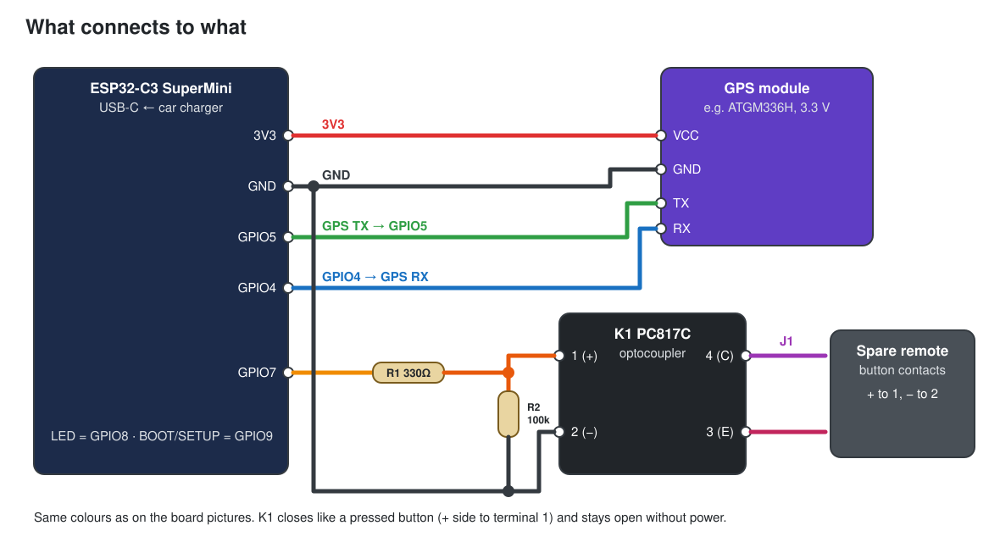
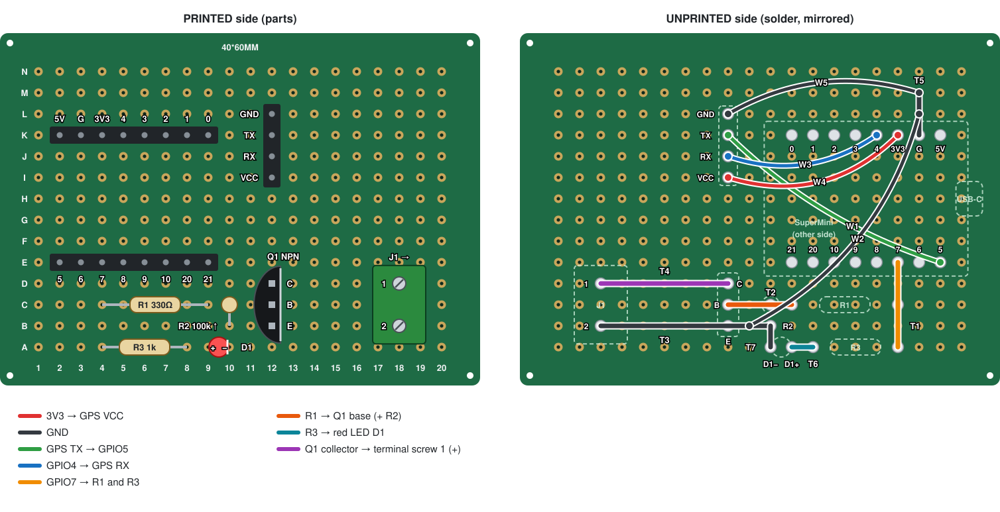
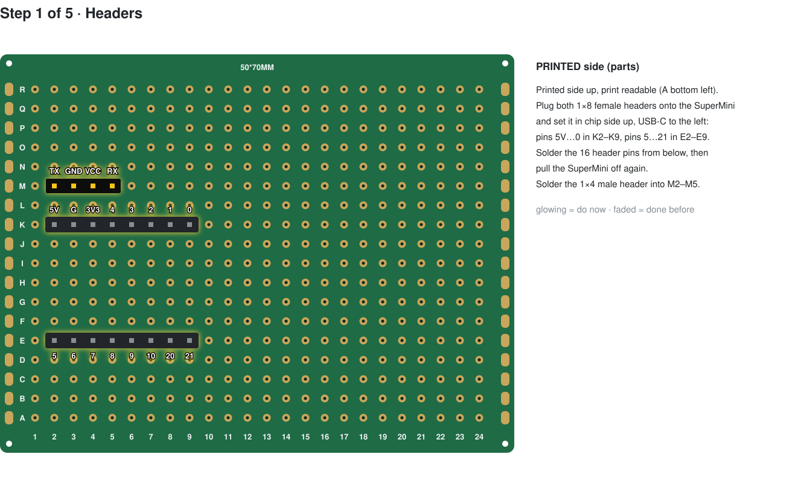
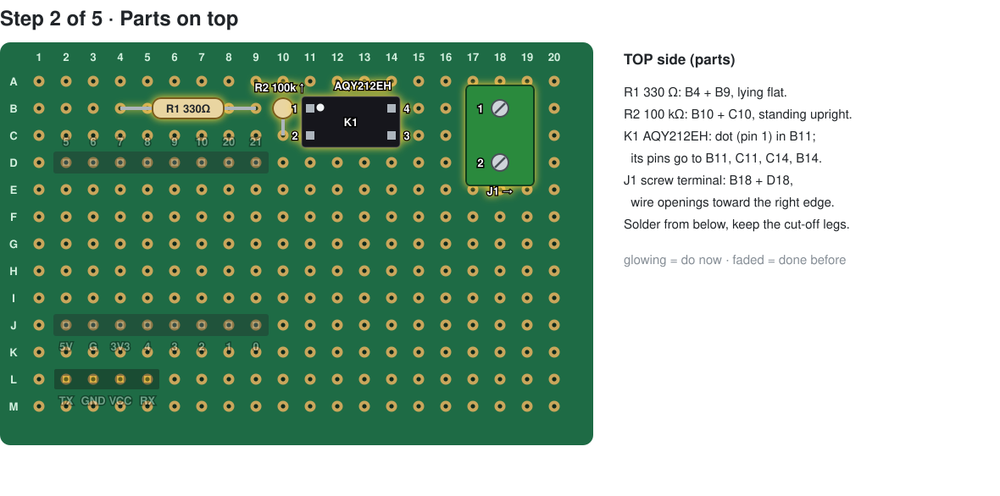
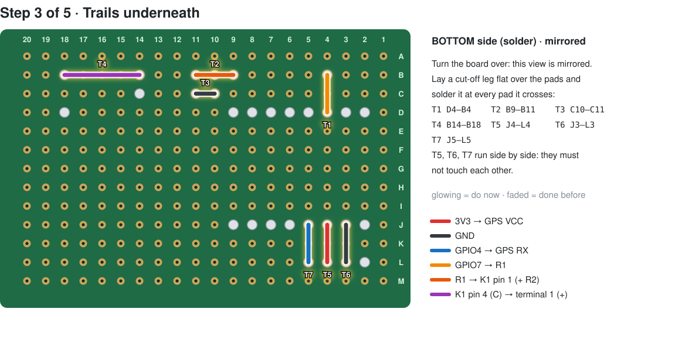
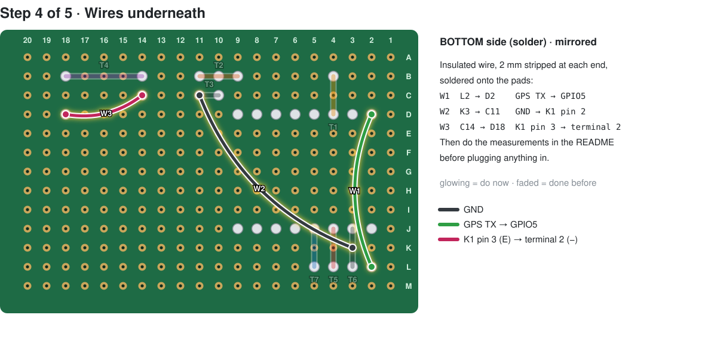
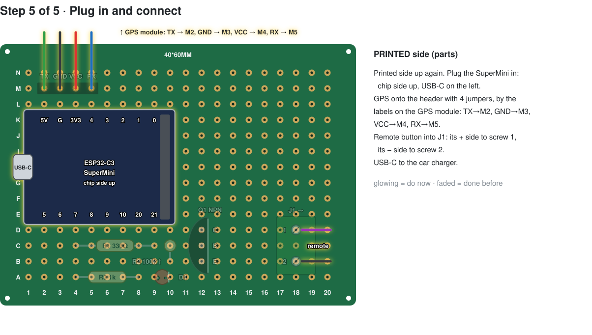

# Prototype build (perfboard)

The garageDoor board, built by hand from ready-made modules on a perfboard. It runs the same firmware
as the PCB version, and the build takes about an hour.

```
            ESP32-C3 SuperMini
car USB-C ─► USB-C
            5V   ───────────────────────────► GPS VCC
            GND  ──────┬────────────┬────────► GPS GND
            GPIO5 ◄────┼────────────┼───────── GPS TX
            GPIO4 ─────┼────────────┼────────► GPS RX
            GPIO7 ── R1 330Ω ──┬── 1 ┌──────────┐ 4 ──► screw terminal 1 ─┐  across the
                               │     │ AQY212EH │                        ├─ remote's
                         R2 100k     │ PhotoMOS │                        │  button
                               │     └──────────┘                        │
            GND ───────────────┴── 2            3 ──► screw terminal 2 ─┘
            GPIO8: blue LED on the SuperMini (status)   GPIO9: BOOT button (= SETUP)
```

- **R1** sets the PhotoMOS LED current (~6 mA).
- **R2** keeps the switch off while the ESP32 boots.
- **The PhotoMOS** connects the two screw-terminal wires exactly like a pressed button: either
  polarity works, and it's fully isolated from the rest of the board. Unpowered, it stays open.



## Parts list

| # | Part | Qty | Notes | ~€ |
|---|------|----:|-------|---:|
| 1 | **ESP32-C3 SuperMini** | 2 | Get the **standard** one, not "SuperMini **Plus**": the Plus has an RGB LED on GPIO8. The second one is a spare. | 3 each |
| 2 | **GPS module, u-blox M10, with built-in ceramic antenna and UART**, e.g. **Beitian BE-220** | 1 | 3.6–5.5 V, 115200 baud by default. Any GPS module with UART output works (NMEA fallback, e.g. BN-220, GY-NEO6MV2), but M10 is the most sensitive. Its TX must be 3.3 V logic, which is normal for these modules. | 12–18 |
| 3 | **AQY212EH** PhotoMOS relay, DIP-4 | 2 | Same pinout alternatives: AQY210EH, TLP222A, Omron G3VM-61A1. LCSC C2894775. The second one is a spare. | 1–2 each |
| 4 | Resistor 330 Ω, ¼ W | 1 | R1. A resistor assortment kit is handy. | – |
| 5 | Resistor 100 kΩ, ¼ W | 1 | R2 | – |
| 6 | Screw terminal, 2-pin, 5.08 mm pitch (KF301-2P / KF128-2P) | 1 | J1, for the remote wires | 0.3 |
| 7 | Perfboard 5 × 7 cm, 2.54 mm, plated holes | 1 | Packs of several are cheap | 1 |
| 8 | Female pin header 1×8, 2.54 mm | 2 | The SuperMini plugs in, so it can be swapped and wires fit underneath | 0.5 |
| 9 | Male pin header 1×4, 2.54 mm | 1 | GPS connector at L2–L5 | 0.2 |
| 10 | 4 female–female Dupont jumper wires, 20–30 cm | 4 | Board header to the GPS module cable (solder and heat-shrink them onto the module's cable) | 1 |
| 11 | Insulated hookup wire, 26–30 AWG (silicone or wire-wrap) | 1 m | W1–W3, and the remote wires | 2 |
| 12 | Bare tinned copper wire, 0.4–0.6 mm | – | Trails T1–T7; the resistor leg offcuts are enough | – |
| 13 | **Spare garage remote** for your door, already working | 1 | It stays in use as the transmitter | own / 15–30 |
| 14 | USB car charger + USB-C cable | 1 | On a socket that **switches off with the ignition** | 10 |
| 15 | Small enclosure (e.g. 70 × 50 × 25 mm) | 1 | Or 3D-print one | 3 |
| 16 | Heat-shrink tubing, double-sided tape / Velcro | – | | – |

Tools: temperature-controlled soldering iron (~330 °C, fine tip), solder 0.5–0.8 mm (leaded Sn60/63
is the easiest), flux pen, flush cutters, tweezers, multimeter with continuity beep.

**Total:** about €25–35 without the remote and charger. The GPS module is the biggest item.

## Layout



Holes are named **row letter + column number**: rows **A–M** top to bottom, columns **1–20** left to
right, looking at the **component side** with the USB-C on the left. The right half of the drawing
is the **bottom** as you see it while soldering, so it's mirrored: column 1 is on the right there.

Turn the 5 × 7 cm board so the **7 cm side is horizontal** (24 × 18 holes), use the top-left
20 × 13 holes, and mark row A and column 1 with a pen before you start. `make_layout.py` draws the picture and checks that the trails and wires produce exactly
the circuit above.

### Bridge, trail or wire?

| Connection | Use | Here |
|------------|-----|------|
| Two **neighbouring** holes (one step) | a short trail, or a **solder bridge**: heat both pads and feed solder until it flows across | T3 |
| A **straight run** over 2+ neighbouring holes | a **trail**: bare tinned wire laid flat over the pads, soldered at **every** pad. Don't chain solder blobs; they crack. | T1, T2, T4–T7 |
| Anything else (corners, long runs, crossing other connections, under the SuperMini) | **insulated wire**, soldered pad to pad on the bottom | W1, W2, W3 |

Keep trails centred on their row. A trail must never touch the pad beside it, so watch the parallel
trails T5/T6/T7 and pads J3/J4/J5. Leave every hole that isn't in the drawing unsoldered.

## Assembly

1. **Check the SuperMini.** The labels on the back should read `5V G 3.3 4 3 2 1 0` on one side and
   `5 6 7 8 9 10 20 21` on the other. If its male pins came loose, solder them on now (long side down).
2. **Female headers.** Plug both 1×8 female headers onto the SuperMini and set it into the board:
   the `5 … 21` row in **D2–D9** and the `5V … 0` row in **J2–J9**, USB-C toward the left edge.
   - The rows are 6 holes (15.24 mm) apart on the SuperMini. If yours don't line up with D and J,
     stop and measure.
   - Solder the header pins from the bottom, then pull the SuperMini off again.

   

3. **Parts on top** (solder from the bottom, and keep the cut-off legs for the trails):
   - **R1 330 Ω:** B4 and B9, lying flat.
   - **R2 100 kΩ:** B10 and C10, standing upright (bend one leg down alongside the body).
   - **K1 AQY212EH:** **pin 1 (dot or notch) in B11**. The pins then go to B11, C11, C14 and B14.
   - **J1 screw terminal:** B18 and D18, with the wire openings toward the right edge.
   - **1×4 male header:** L2–L5 (the GPS connector).

   

4. **Trails on the bottom:** T1 D4–C4–B4, T2 B9–B10–B11, T3 C10–C11, T4 B14 → B18 along row B,
   T5 J2–K2–L2, T6 J3–K3–L3, T7 J5–K5–L5.

   

5. **Wires on the bottom:**
   - **W1:** L4 → D2 (GPS TX → GPIO5).
   - **W2:** K3 → C11 (GND → K1 pin 2).
   - **W3:** C14 → D18 (K1 pin 3 → terminal 2).

   

6. **Measure before plugging anything in** (multimeter, SuperMini still unplugged):

   | Between | Expect |
   |---------|--------|
   | J2 (5V) and J3 (GND) | **open, no beep**. If this beeps, find the short before going on. |
   | J2 and L2, J3 and L3, J5 and L5, D2 and L4 | beep (connected) |
   | D4 (GPIO7) and B11 (K1 pin 1) | ~330 Ω |
   | B11 and J3 (GND) | ~100 kΩ (some meters show less: their test voltage lights the PhotoMOS LED) |
   | C11 and J3 | beep |
   | Terminal screw 1 and B14 / screw 2 and C14 | beep |
   | Terminal screw 1 and screw 2 | open |
   | Every pair of neighbouring pads in D2–D9 and J2–J9 | open (except J2/J3, already checked) |
7. **GPS cable.**
   - Cut the module's cable and solder 4 Dupont jumpers to it, matching the labels **on the module**.
     Wire colours are not standard.
   - Then plug them onto the board header: **VCC → L2, GND → L3, TX → L4, RX → L5**.

   

8. **Plug in the SuperMini** and flash it from the Mac, with the SuperMini on USB:

   ```bash
   cd firmware && . ~/esp/esp-idf/export.sh && idf.py build flash monitor
   ```

   If no `/dev/cu.usbmodem…` port shows up, hold BOOT while plugging in the USB.

## Bench test

1. **First start:** the log says `start: NO_HOME` and the blue LED blinks fast, because the setup
   Wi-Fi is on.
2. **GPS:** near a window, the log shows `receiver found at 115200 baud (UBX)` (or NMEA for other
   modules). Within about a minute the panel shows a fix.
3. **Panel:** on the phone, join **GarageDoor-XXXX** (password `garagedoor`), set your own password,
   then tap **Press the remote once**. A multimeter in continuity mode across the two terminal screws
   beeps briefly.
4. **Remote:** open the spare remote and solder two thin wires across the button's contacts (the two
   sides it connects). Screw them into J1 (either way round). Test press again: the door reacts.

## Install in the car

- **Board:** put it in the enclosure and mount it out of direct sun (console, glovebox).
  - Wi-Fi is only used for setup, with the phone right next to it, so the board's position doesn't
    matter for range. That was different for the old beacon.
  - Still, don't put the SuperMini's antenna end (opposite the USB-C) against metal.
- **GPS module:** put it where it sees the sky, e.g. on the dashboard under the windscreen, ceramic
  side up, and run its cable to the box.
- **Power:** USB-C from the ignition-switched charger.
- **Setup:** follow `docs/user-guide.md` from "Set it up".
